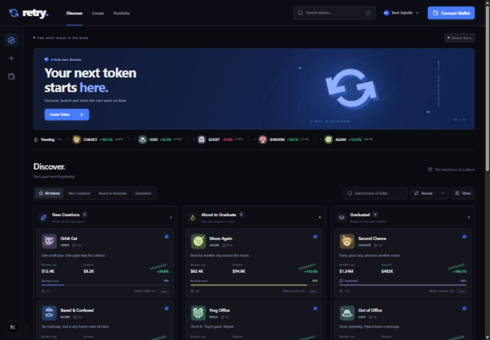

# RETRY

Base-native memecoin discovery and launchpad foundation. Product name: **RETRY** (`retry.`); repository: `launchpadlendaria`.



This branch is the integrated app: the Stage 1 Next.js interface with the Stage 2 wallet module (`@retry/web3`) wired into its header and pages. How the two were combined, what was tested and what is still open is in the [integration report](docs/reports/RETRY_FRONTEND_WEB3_INTEGRATION_REPORT.md) (Portuguese). Stage 4 replaced the fictional market data with real, read-only Base data: see the [market data report](docs/reports/RETRY_REAL_MARKET_DATA_INTEGRATION_REPORT.md) (Portuguese).

## What works

- **Discover:** a featured token tracked on Base (an external token, not a RETRY launch) with its real price, 24 h change, volume, liquidity and calculated FDV; search by name, ticker or contract address (full or prefix); sorting by liquidity or volume and a minimum-liquidity filter. RETRY's own "new" and "graduated" columns stay empty until the token factory exists.
- **`/token/base/<address>/`:** the token's identity read from Base mainnet (name, symbol, decimals, supply, B20 standard), market stats with their source and update time, OHLCV candles for 5m, 15m, 1h, 4h and 1d, up to 1,000 per interval (GeckoTerminal's largest page), on an interactive chart (drag freely in either direction, wheel or pinch to zoom in or out past the whole history, dates on the UTC axis, optional log scale, the pool's all-time high as a dashed line; it opens on the newest candles, and like TradingView it draws candles side by side, skipping intervals without trades instead of filling them in), market activity of all traders in the primary pool, the eligible pools and why one is primary, and a view-only Buy/Sell panel. `/token/?address=0x…` inspects any Base contract and explains when it is not a token.
- **`/create`:** validated details, local image preview, live token preview, three steps and a versioned browser-local draft. The launch summary shows the connected wallet; launching stays disabled.
- **`/portfolio`:** wallet prompt, connected account, wallet name, network, real native ETH balance, the tracked token's balance on Base mainnet (`balanceOf`) with a value labeled as derived from the pool price, and an explorer link. Other tokens and the wallet's history are not indexed and say so.
- **Wallet:** one `Connect Wallet` button in the header for browser wallets announced through EIP-6963 (MetaMask, Phantom EVM, Rabby, Brave, …), the MetaMask SDK, Coinbase Wallet / Smart Wallet and, when configured, WalletConnect. The account menu has copy address, explorer link, balance, network switch between Base Sepolia and Base, and disconnect. Any other chain shows `Wrong Network` with a switch button. The session survives navigation and reloads.
- Original SVG brand; tracked tokens show a reviewed logo stored in `public/tokens/` (never a hotlinked image), other tokens a monogram; keyboard-accessible dialogs, responsive layouts (the wallet menu is a bottom sheet on phones) and reduced-motion support.

**No contract, swap, approval, signature, launch, fee collection or transfer is implemented.** Connecting only asks the wallet for its accounts. Market data is real and read-only: every figure shows its source and update time, and anything a provider does not report reads **Unavailable**, never zero. Market cap is not shown because circulating supply is not verified; FDV is on-chain total supply × primary-pool price and is labeled as calculated. The trade panel shows no quote, route or fee and its execution is disabled. Balances are real RPC reads; when a read fails the UI says so and shows no number. Economic terms of RETRY's own launches remain undecided.

## Market data

Market data is fetched by the browser from two public, keyless APIs, so the static GitHub Pages export needs no server and holds no secret:

- [GeckoTerminal API](https://www.geckoterminal.com/dex-api) (primary): pools, OHLCV candles and trades. About 30 requests a minute per visitor.
- [DEX Screener API](https://docs.dexscreener.com/api/reference) (fallback): pools and statistics only. When it is used the source line says "(fallback)" and the chart and activity say they are unavailable instead of showing other data.

Requests go only to those two hosts (`src/lib/market/http.ts`), time out after 10 s and refresh every 1 to 10 minutes. Responses are validated field by field and converted to exact decimals before display. The token's identity comes from Base mainnet RPC (one Multicall3 call). Tracked tokens, their verified identity and the configured primary pool live in [`src/config/featured-assets.ts`](src/config/featured-assets.ts); the read-only workflow `.github/workflows/market-data-verify.yml` re-checks a token on chain and against both providers. Neither API has an SLA; their terms of use must be reviewed before a production launch.

## Run locally

Use Node.js 24 LTS and pnpm 11.25.0 (declared in `packageManager`; see the [installation guide](https://pnpm.io/installation)). The repository is a pnpm workspace: the app at the root, the wallet module in `packages/retry-web3` and its test bench in `examples/web3-playground`. One install covers all three.

```sh
pnpm install --frozen-lockfile
pnpm dev
```

Open [http://127.0.0.1:3000](http://127.0.0.1:3000). The default network is **Base Sepolia** (84532). No environment variable or wallet is needed to browse, search or save a draft. `pnpm dev`, `build`, `typecheck` and `test` compile `@retry/web3` first.

## Configuration

Copy `.env.example` to `.env.local` and restart the server after changing a value.

| Variable                               | Default / purpose                                                                                           |
| -------------------------------------- | ----------------------------------------------------------------------------------------------------------- |
| `NEXT_PUBLIC_DEFAULT_NETWORK`          | `base-sepolia` (84532). `base` (8453) makes Base the target network; still read-only                        |
| `NEXT_PUBLIC_BASE_SEPOLIA_RPC_URL`     | Public Base Sepolia RPC (`https://sepolia.base.org`)                                                        |
| `NEXT_PUBLIC_BASE_RPC_URL`             | Public Base RPC (`https://mainnet.base.org`)                                                                |
| `NEXT_PUBLIC_WALLETCONNECT_PROJECT_ID` | Optional [Reown project ID](https://dashboard.reown.com/). Empty: WalletConnect is listed as not configured |

Every `NEXT_PUBLIC_` value ends up in the browser bundle. Use only public RPC endpoints or keys restricted to your domains; never put a private key, seed phrase or provider secret here. WalletConnect must allow the development and production origins. There is deliberately **no variable that enables trading or launches**: financial operations are off in code (`RETRY_FINANCIAL_OPERATIONS_ENABLED = false` in `@retry/web3`) until contracts exist and have been reviewed.

Chain definitions come from viem. See the [Base network parameters](https://docs.base.org/get-started/connect-to-base), [docs/web3/BASE_NETWORKS.md](docs/web3/BASE_NETWORKS.md) and [docs/web3/WALLET_INTEGRATION.md](docs/web3/WALLET_INTEGRATION.md).

## Checks

```sh
pnpm format:check
pnpm lint
pnpm typecheck
pnpm test                             # unit tests and the React integration test of the wallet flow
pnpm test:e2e                         # Playwright on the static export, desktop and Pixel 7
pnpm --filter @retry/web3 check       # module: types, lint, unit tests, build
pnpm --filter retry-web3-playground exec playwright test   # test bench browser tests
```

The integration and browser tests use a simulated wallet (an EIP-6963 mock provider), a mocked Base RPC and recorded GeckoTerminal and DEX Screener responses (`tests/fixtures/market-responses.ts`). They prove the app's behaviour, not compatibility with a particular wallet; real-wallet results are tracked in [docs/web3/WALLET_INTEGRATION.md](docs/web3/WALLET_INTEGRATION.md). The first `pnpm test:e2e` needs `pnpm exec playwright install chromium`.

`pnpm format` formats source and documentation. `node scripts/generate-assets.mjs` regenerates the original SVG assets (the demo token art in `public/tokens/` is no longer used by the app).

## Build

```sh
pnpm build && pnpm start      # Node-hosted Next.js app
pnpm build:pages              # static export in out/ under /launchpadlendaria
pnpm preview:pages            # serves out/ at http://127.0.0.1:4174/launchpadlendaria/
```

`build:pages` sets `RETRY_STATIC_EXPORT=1` and the base path from `NEXT_PUBLIC_BASE_PATH` (default `/launchpadlendaria`). Assets and routes include it. A page is generated for each tracked token in `src/config/featured-assets.ts`; market data is loaded in the browser, so the exported HTML contains no prices.

## Web3 test bench

`examples/web3-playground` is a small Vite app that exercises `@retry/web3` on its own: every connector, the network scenarios, balance states and configuration warnings. It is a developer tool, not part of the product, and is linked from the footer as "Web3 test bench". Run it with `pnpm --filter retry-web3-playground dev`; its variables use the `VITE_` prefix (see its `.env.example`).

## Deployment

CI (`.github/workflows/ci.yml` and `retry-web3.yml`) runs the checks above on every push and pull request with read-only permissions and never deploys. The Pages export is uploaded as a 7-day build artifact for review.

`.github/workflows/pages.yml` publishes this app from `main` at <https://arthurbudagmatsuda.github.io/launchpadlendaria/>, with the Web3 test bench at `/web3/`. Pushes to other branches do not publish anything; see [docs/integration/GITHUB_PAGES.md](docs/integration/GITHUB_PAGES.md).

GitHub Pages is static hosting: the security headers in `next.config.ts` apply only to the Node build, and the wallet session is restored in the browser after load. MetaMask currently flags the shared `*.github.io` domain on its connect screen; a public launch should use RETRY's own domain.

## Layout

```text
src/app/                   Next.js App Router pages and global design tokens
src/components/            UI primitives, layout, Discover, Trade, Create, Portfolio, wallet status
src/config/                Web3 configuration (env → @retry/web3), chain helpers and tracked tokens
src/hooks/                 Browser-local token draft and market data queries
src/lib/                   Formatting, validation and class utilities
src/lib/market/            Market data: providers, validation, exact decimals, pool policy, on-chain reads
packages/retry-web3/       @retry/web3: wagmi config, provider, hooks, wallet UI, test helpers
examples/web3-playground/  Standalone Web3 test bench (Vite)
tests/                     Vitest unit tests, tests/integration (jsdom wallet flow) and tests/fixtures
e2e/                       Playwright tests of the static export with a mock wallet, RPC and providers
scripts/                   Asset generation, Pages build and local Pages server
public/brand/, tokens/     Original RETRY vectors (tokens/ holds the unused demo art)
docs/                      PRD, architecture, roadmap, decisions, Web3 docs, reports
```

## Images and drafts

Uploads stay in the browser, never on a server. Only PNG, JPEG and WebP up to 2 MB and 4096 × 4096 are accepted; MIME type, file signature and image decoding are checked. SVG/HTML/remote uploads are rejected. Metadata lengths, symbols and HTTPS/social domains are validated. Text is rendered through React without raw HTML.

Drafts use `retry:token-draft:v1` in localStorage. Browser storage is untrusted and sanitized when restored. Reset draft clears the working draft. If storage is unavailable or full, the draft stays in memory with a warning. Disconnecting a wallet does not touch the draft. Do not enter sensitive information into public token metadata.

## Known boundaries and next stage

No indexer, persistent backend, deployed contracts, financial operations or swap integrations exist. Market data depends on the public GeckoTerminal and DEX Screener APIs (rate limited, no SLA); holders and circulating supply are not indexed. Public RPC endpoints throttle; production needs a dedicated provider. A configured connector is not evidence of a tested wallet: see [docs/VERIFICATION.md](docs/VERIFICATION.md) and the real-wallet matrix in [docs/web3/WALLET_INTEGRATION.md](docs/web3/WALLET_INTEGRATION.md).

Next: confirm protocol parameters, then the token factory and ERC-20, bonding curve, graduation and liquidity lock, indexer, contract integration in this app, end-to-end tests on Base Sepolia and a security review before any mainnet use. See [docs/ROADMAP.md](docs/ROADMAP.md) and [docs/TOKENOMICS_DECISIONS.md](docs/TOKENOMICS_DECISIONS.md).

Repository: [ArthurBudagMatsuda/launchpadlendaria](https://github.com/ArthurBudagMatsuda/launchpadlendaria).
