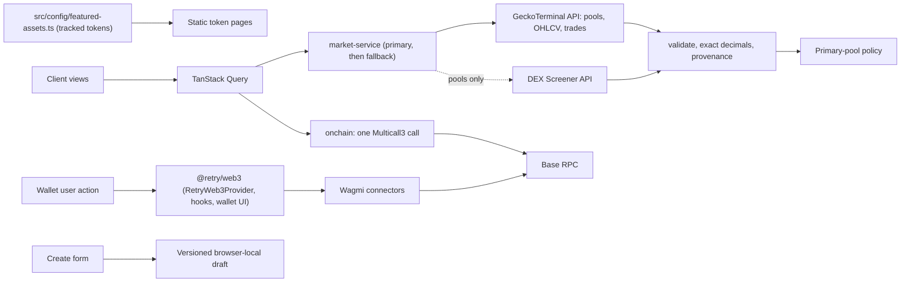

# RETRY — Architecture

## Runtime and composition

Next.js App Router with React, strict TypeScript and Tailwind 4. Pages render static shells; client views fetch market data in the browser through TanStack Query, so the static export carries no prices and needs no server. Radix Dialog supplies focus trapping, keyboard dismissal and accessible modal semantics. A small shadcn-style button primitive uses `clsx`/`tailwind-merge`; there is no large component framework. CSS transitions provide lightweight animation, with reduced-motion overrides. The price chart uses TradingView's open-source Lightweight Charts (Apache-2.0, with its attribution logo), loaded only on token detail views through a dynamic import. Candles sit side by side as on TradingView: an interval without trades is skipped and counted in the source line, never filled in. The all-time high is the highest high in the primary pool's daily candles (and any newer intraday candle on screen); it is drawn as a dashed line and listed with the price changes.

Design tokens are in `src/app/globals.css`: charcoal background, dark surfaces, discreet borders, electric blue brand, occasional lime, independent positive/negative colors. The original cycling mark is supplied as SVG for full/compact contexts and favicon. A tracked token can carry a reviewed logo in `src/config/featured-assets.ts`: the provider's file is stored under `public/tokens/` with its source URL, SHA-256 and the run that fetched it, so visitors never request a third-party image. Other tokens get a monogram built from their verified symbol. The system font stack keeps the build independent of external font downloads.

## Data flow

`src/lib/market/` is the market data layer. Provider adapters (`providers/geckoterminal.ts`, `providers/dexscreener.ts`) are the only code that knows a provider's JSON; they validate every field (`validate.ts`) and return normalized types (`types.ts`): `PoolMarket`, `CandleSeries` and `TradeList`, each with `Provenance` (source, chain, token, pool, retrieval time and, when given, observation time). Prices, liquidity, volume and FDV are exact decimal strings backed by scaled bigints (`decimal.ts`); candle values are numbers only because the chart draws them. Labels from providers or contracts are stripped of control and bidi characters.

`http.ts` fetches only from a fixed allowlist (`api.geckoterminal.com`, `api.dexscreener.com`) with a 10 s timeout and maps failures to `MarketDataError` codes (`RATE_LIMITED` with `Retry-After`, `HTTP_ERROR`, `TIMEOUT`, `NETWORK`, `INVALID_RESPONSE`, …). Queries retry once on timeouts, network errors and 5xx, never on 429. `market-service.ts` asks GeckoTerminal first and DEX Screener second, returns the first answer that has an eligible pool and reports which source and whether the fallback was used. OHLCV and trades come from GeckoTerminal only: when it fails the chart and activity say so, nothing substitutes them.

`pool-selection.ts` picks the primary pool: the tracked address must be the base token, the quote must be native ETH, WETH or USDC, liquidity at least $1,000 and at least one trade in 24 h; eligible pools rank by liquidity, then 24 h volume, then pool ID. A pool pinned in the config wins while it stays eligible; otherwise the UI says it fell back. Pools are never summed. This matters for the featured token: a look-alike token with the same symbol pairs against it with inflated reserves, and those pools are never eligible.

`onchain.ts` reads the token's identity from Base mainnet in one `aggregate3` call (ERC-20 name, symbol, decimals, total supply and the B20 factory's `isB20Initialized`), checks the RPC's chain ID first and keeps RPC failures distinct from "no contract" or "not ERC-20". Base B20 tokens are precompiles whose code is the single byte `0xef`, so bytecode length alone proves nothing. FDV is on-chain total supply × primary-pool price (`metrics.ts`); market cap is not shown because circulating supply is not verified. Figures are "live" until twice their refresh interval has passed, then "stale" with their own timestamp.

Query keys include chain, token address, pool and interval. Pools and trades refresh every 60 s and candles every 60 s (5m) to 10 min (4h, 1d), paused in background tabs; a token page makes about three GeckoTerminal requests a minute, well under its limit of about 30. The on-chain identity is cached for 5 min and reread on the next visit after that.

Pages for tracked tokens are generated at build time from `TRACKED_ASSETS` (`generateStaticParams`, `dynamicParams = false`), so unknown routes get a real 404. Any other Base address uses the client route `/token/?address=0x…`, which shows market data only after the contract answers as an ERC-20 token. Tokens are identified by chain ID plus checksummed address, never by symbol, and a token tracked by RETRY is labeled as external, never as a RETRY launch. The fictional Stage 1 catalogue now lives in `tests/fixtures/demo-market.ts`; `tests/no-mock-leakage.test.ts` fails if production code imports it.

## Wallet boundaries

All wallet state comes from the workspace package `@retry/web3` (`packages/retry-web3`): `src/config/web3.ts` builds its config from the `NEXT_PUBLIC_*` variables, and `Providers` wraps the app in its `RetryWeb3Provider` (wagmi 3 + the one TanStack `QueryClient` that Discover and the token terminal also use). The header uses the module's `ConnectWalletButton` and `NetworkIndicator`; Portfolio, the trade panel and Create's Launch Summary read `useRetryWallet`/`useRetryBalance`. The config and QueryClient are created once per provider instance, avoiding server request-shared state, and wagmi's `ssr` mode keeps the first client render equal to the server render. Base Sepolia is the default target; chain definitions come from viem. Read transports are bounded with timeouts/retries; errors never substitute fixture balances.

Connectors: EIP-6963/injected wallets (MetaMask, Phantom, Rabby…), MetaMask SDK, Coinbase Wallet and WalletConnect when a project ID is set. The menu shows the address, network, balance and explorer link, and offers copy, switch to the target network and disconnect. Accounts and chains follow connector events. No `sendTransaction`, `writeContract`, signing, allowance or swap execution is imported. `financialActionsEnabled` (re-exported from `RETRY_FINANCIAL_OPERATIONS_ENABLED`) remains false; UI actions never reach a financial adapter.

The trade panel shows no quote: quote, route and network fee read "not available" and execution is disabled. Slippage is UI configuration only. Fees, supply and graduation terms are unresolved. No formula in this code represents the future curve.

## Browser state and validation

Drafts use a versioned localStorage key with sanitized restoration and an in-memory fallback. Cross-tab storage notifications update subscribers; functional updates prevent late image uploads from overwriting newer text edits. Image uploads check size, MIME, signature, decoding and dimensions. Only raster data URLs produced from accepted files are previewed. A later upload API must repeat validation server-side, strip metadata, re-encode and serve through a constrained media origin. Current metadata is never uploaded or published.

## Future contracts and infrastructure

Future factory/ERC-20 contracts, curve reserves and trading execution must be specified and audited separately. Indexed events improve discovery but cannot authorize execution. Onchain balances, reserves and verified simulations must be reread before signing. Graduation should be an idempotent contract transition with a reviewed DEX adapter and explicit liquidity ownership/locking policy. No contracts or deployment keys are present now.

## Delivery and tradeoffs

ESLint 10 is used with Next.js 16.4, whose bundled official ESLint guide explicitly supports it. Some inherited React/accessibility/import plugins still declare legacy peer ranges, so pnpm reports peer warnings despite successful lint execution. TypeScript is pinned to 5.9 because the installed typescript-eslint stack does not support TypeScript 7. Revisit these version boundaries when upstream dependencies update.

GitHub Actions validates frozen-lockfile installation, formatting, lint, type generation/checking, unit tests and production build. The optional Pages preview uses a separate `build:pages` export mode with a build-time repository prefix, browser-side query strings and pre-generated pages for the tracked tokens. The normal Node-hosted build remains supported. GitHub Pages controls response headers in static mode; application-level Next.js headers apply only in server mode.

Until the switch described in `docs/integration/GITHUB_PAGES.md` is approved, the Pages workflow checks out the Stage 1 application and Stage 2 Web3 playground separately, validates each, then combines their static outputs under the shared project site (`/` and `/web3/`). It does not merge the source histories or silently integrate the experimental Web3 package into the application. The same workflow is installed on both source branches and the default branch to support pushes and manual reruns. The deployment job alone receives `pages:write` and `id-token:write`; build jobs only read repository/Pages metadata. Source revisions are recorded in a public text file containing only commit hashes.

No database or server mutations are needed for browser-local drafts and read-only market browsing. Wallet providers necessarily introduce optional third-party transport/UI dependencies; their licenses and runtime behavior need review before production. Only required build scripts are allowed by the pnpm workspace policy.
