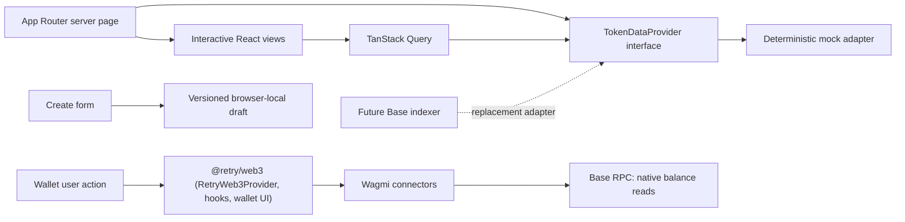

# RETRY — Architecture

## Runtime and composition

Next.js App Router with React, strict TypeScript and Tailwind 4. Server pages resolve the token provider and pass serializable fixtures to narrowly interactive client views. Radix Dialog supplies focus trapping, keyboard dismissal and accessible modal semantics. A small shadcn-style button primitive uses `clsx`/`tailwind-merge`; there is no large component framework. CSS transitions provide lightweight animation, with reduced-motion overrides. Recharts is loaded only on token detail views through a dynamic import.

Design tokens are in `src/app/globals.css`: charcoal background, dark surfaces, discreet borders, electric blue brand, occasional lime, independent positive/negative colors. The original cycling mark is supplied as SVG for full/compact contexts and favicon. Token illustrations are local original SVGs and do not require external image services or tracking. The system font stack keeps the build independent of external font downloads.

## Data flow

`TokenDataProvider` defines list/get/history/trades. All fixtures are typed and shared. IDs and fixture timestamps are fixed; relative ages use the same snapshot clock on client and server, avoiding hydration drift. Query keys include token ID/interval and identify the demo catalog. Adapter replacement must add provenance, chain identity, pagination and error handling before publishing real data.

The finite demo token pages are generated at build time with `generateStaticParams` and `dynamicParams = false`, giving unknown IDs a real HTTP 404 before streaming begins. When replacing the catalog with a live registry, revisit static generation and choose a network-aware caching/404 strategy instead of retaining this finite-list constraint.

Entities: Token, TokenMetadata, TokenMarketData, TokenLaunch, BondingCurveState, PricePoint, Trade and UserPortfolio. Demo references are intentionally not EVM addresses. A real explorer link is only rendered for a non-demo deployed address. A production provider should retain explicit network identity per token before multi-environment indexed data is added.

## Wallet boundaries

All wallet state comes from the workspace package `@retry/web3` (`packages/retry-web3`): `src/config/web3.ts` builds its config from the `NEXT_PUBLIC_*` variables, and `Providers` wraps the app in its `RetryWeb3Provider` (wagmi 3 + the one TanStack `QueryClient` that Discover and the token terminal also use). The header uses the module's `ConnectWalletButton` and `NetworkIndicator`; Portfolio, the trade panel and Create's Launch Summary read `useRetryWallet`/`useRetryBalance`. The config and QueryClient are created once per provider instance, avoiding server request-shared state, and wagmi's `ssr` mode keeps the first client render equal to the server render. Base Sepolia is the default target; chain definitions come from viem. Read transports are bounded with timeouts/retries; errors never substitute fixture balances.

Connectors: EIP-6963/injected wallets (MetaMask, Phantom, Rabby…), MetaMask SDK, Coinbase Wallet and WalletConnect when a project ID is set. The menu shows the address, network, balance and explorer link, and offers copy, switch to the target network and disconnect. Accounts and chains follow connector events. No `sendTransaction`, `writeContract`, signing, allowance or swap execution is imported. `financialActionsEnabled` (re-exported from `RETRY_FINANCIAL_OPERATIONS_ENABLED`) remains false; UI actions never reach a financial adapter.

The trade illustration uses a static fixture ratio, independent from demo USD prices. Slippage is UI configuration only. Fees, supply and graduation terms are unresolved. No formula in this code represents the future curve.

## Browser state and validation

Drafts use a versioned localStorage key with sanitized restoration and an in-memory fallback. Cross-tab storage notifications update subscribers; functional updates prevent late image uploads from overwriting newer text edits. Image uploads check size, MIME, signature, decoding and dimensions. Only raster data URLs produced from accepted files are previewed. A later upload API must repeat validation server-side, strip metadata, re-encode and serve through a constrained media origin. Current metadata is never uploaded or published.

## Future contracts and infrastructure

Future factory/ERC-20 contracts, curve reserves and trading execution must be specified and audited separately. Indexed events improve discovery but cannot authorize execution. Onchain balances, reserves and verified simulations must be reread before signing. Graduation should be an idempotent contract transition with a reviewed DEX adapter and explicit liquidity ownership/locking policy. No contracts or deployment keys are present now.

## Delivery and tradeoffs

ESLint 10 is used with Next.js 16.4, whose bundled official ESLint guide explicitly supports it. Some inherited React/accessibility/import plugins still declare legacy peer ranges, so pnpm reports peer warnings despite successful lint execution. TypeScript is pinned to 5.9 because the installed typescript-eslint stack does not support TypeScript 7. Revisit these version boundaries when upstream dependencies update.

GitHub Actions validates frozen-lockfile installation, formatting, lint, type generation/checking, unit tests and production build. The optional Pages preview uses a separate `build:pages` export mode with a build-time repository prefix, browser-side query strings and a pre-generated finite token catalog. The normal Node-hosted build remains supported. GitHub Pages controls response headers in static mode; application-level Next.js headers apply only in server mode.

Until the switch described in `docs/integration/GITHUB_PAGES.md` is approved, the Pages workflow checks out the Stage 1 application and Stage 2 Web3 playground separately, validates each, then combines their static outputs under the shared project site (`/` and `/web3/`). It does not merge the source histories or silently integrate the experimental Web3 package into the application. The same workflow is installed on both source branches and the default branch to support pushes and manual reruns. The deployment job alone receives `pages:write` and `id-token:write`; build jobs only read repository/Pages metadata. Source revisions are recorded in a public text file containing only commit hashes.

No database or server mutations are needed for browser-local drafts and demo browsing. Wallet providers necessarily introduce optional third-party transport/UI dependencies; their licenses and runtime behavior need review before production. Only required build scripts are allowed by the pnpm workspace policy.
