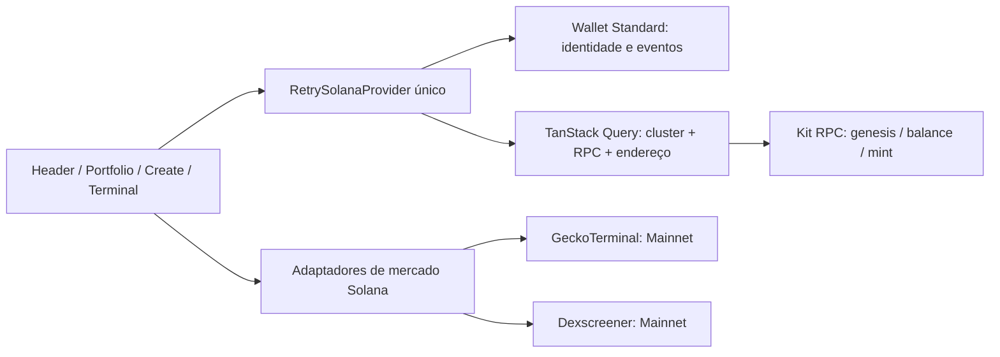

# RETRY — Arquitetura Solana

Estado em 28/10/2026. A aplicação é Next.js 16, React 19 e TypeScript. A identidade visual, os componentes de formulário e `lightweight-charts` foram preservados. O protocolo financeiro ainda não existe. A especificação Base anterior é histórica.

## Fluxo implementado

Nenhuma feature de assinatura ou envio é usada. O provider não importa conectores Ethereum. O registro Wallet Standard detecta as carteiras; o SDK Kit valida endereços e preserva inteiros de RPC. `QueryClient` é criado por instância do provider. Dados de mercado ficam em memória; não existe cache persistente de preços nem service worker nesta versão.

`src/config/solana.ts` define os ambientes; `src/lib/solana` implementa leituras e modelos. A identidade de um token inclui cluster, mint e programa dono. Um endereço base58 válido sozinho não comprova um mint. O RPC precisa ter o genesis correto, o account owner precisa ser um Token Program permitido e o layout precisa ser um mint inicializado.

## Arquitetura futura: proposta, sem programa executável

Antes de escrever Rust/Anchor, aprovar a economia e decidir entre integrar um protocolo de lançamento existente ou desenvolver uma curva própria. Não duplicar uma curva própria e uma curva DEX sem definir quem é a fonte de verdade.

| Componente proposto   | Responsabilidade                                                  | Limite de confiança                                                                           |
| --------------------- | ----------------------------------------------------------------- | --------------------------------------------------------------------------------------------- |
| Configuração global   | Versão, ativos permitidos, limites, estado de pausa e autoridades | Alterações administrativas precisam de multisig e política de upgrade definida                |
| Estado por lançamento | Mint, criador, parâmetros aprovados, reservas e fase              | PDA com seeds versionadas; owner, bump e vínculo com mint conferidos                          |
| Vaults                | SOL/WSOL e tokens pertencentes ao lançamento                      | PDA assinante apenas nas instruções previstas; fundos e taxas contabilizados separadamente    |
| Curva e emissão       | Cotações determinísticas e invariantes de conservação             | Aritmética inteira com limites, arredondamento e valores mínimos explícitos                   |
| Migração              | Transição idempotente para um DEX aprovado                        | CPI com program IDs e contas permitidos; rejeitar substituição de contas e migração duplicada |
| Evidência de liquidez | Destino da posição/LP, lock e direitos de taxas                   | Separar retirada de principal, cobrança de taxas e upgrade do programa externo                |
| Indexador             | Eventos, metadados, assinaturas, posições e histórico             | RPC e programa são fonte primária; finality, rollback e replay documentados                   |

Interfaces conceituais: `initialize_config`, `initialize_launch`, `quote`, `buy`, `sell`, `graduate`, `claim_fees`, `pause`. São nomes de planejamento, sem builders ou instruções implementados. IDL, seeds definitivas, contas, discriminadores, limites de compute/transaction size, autoridade de upgrade e permissões permanecem pendentes. O frontend receberá apenas IDs/IDL revisados por cluster em etapa posterior.

Testes futuros: simulação econômica independente; propriedades de conservação e monotonicidade; limites `u64` e intermediários maiores; ataques com contas falsas, CPI e Token-2022; retries e falhas entre etapas de graduação; preservação do preço e prova de lock. Começar localmente e em Devnet, com valores de teste e autorização específica.

Fontes: [modelo de contas Solana](https://solana.com/docs/core/accounts), [PDAs](https://solana.com/docs/core/pda), [CPI](https://solana.com/docs/core/cpi), [SDK oficial](https://solana.com/docs/clients/official/javascript).
