# RETRY + Meteora — Arquitetura

Estado em 29/10/2026, etapas 3 a 6: branch `feat/retry-meteora-create-trade-graduate` (Draft PR #9), empilhada sobre `feat/retry-meteora-dbc-mvp` (PR #8), que está sobre `migration/retry-solana` (PR #6). Devnet ligada com a config RETRY registrada. Mainnet bloqueada por constante no código.

## Ideia central

A RETRY não tem programa on-chain próprio. Cada token lançado pela RETRY é uma pool do **Meteora Dynamic Bonding Curve (DBC)** criada a partir de **uma única config de parceiro RETRY por cluster**. A config é o que identifica um token RETRY on-chain: o Discover lista as pools do programa DBC filtradas por essa config. Quando a curva completa, a pool gradua para **Meteora DAMM v2** (`cp_amm`) com a liquidez travada para sempre, e a negociação continua na mesma página do token, agora contra a pool DAMM v2.

```mermaid
flowchart LR
  UI[Create / Token / Discover / Portfolio] --> Hooks[src/hooks/use-retry.ts]
  Hooks --> Ctx[MeteoraContext: Connection + cluster + config + fee claimer]
  Provider[RetrySolanaProvider: Wallet Standard + cluster + RPC] --> Ctx
  Ctx --> DBC[SDK DBC 2.0.0: criação, curva, migração]
  Ctx --> DAMM[SDK DAMM v2 1.5.1: pool graduada, sob demanda]
  DBC --> Builder[Transação web3.js v1]
  DAMM --> Builder
  Builder --> Guard[validateTransaction: allowlist de instruções e contas]
  Guard --> Sim[simulateTransaction]
  Sim --> Wallet[Wallet Standard solana:signTransaction]
  Wallet --> Check[validateSigned + verifySignatures]
  Check --> Store[(Registro da operação no navegador)]
  Store --> Send[sendRawTransaction com preflight + confirmação]
  Send --> Refresh[Invalidação das queries]
```

## Fonte única de verdade

- **Carteira, cluster e RPC** continuam vindo do `RetrySolanaProvider` do PR #6 (Wallet Standard + `@solana/kit`). Nada foi substituído.
- `meteoraContext(config)` (`src/lib/meteora/client.ts`) cria a `Connection` do web3.js v1 a partir do mesmo RPC e do mesmo cluster, com a config e o fee claimer registrados em `RETRY_DBC_CONFIGS`. Os SDKs da Meteora usam web3.js v1; o Kit continua servindo as leituras antigas.
- `assertCluster` confere o genesis hash do RPC antes de qualquer transação. Se o RPC não for do cluster selecionado, nada é montado.
- `walletSigner` (`src/lib/meteora/wallet-signer.ts`) adapta a conta Wallet Standard conectada ao `Transaction` do web3.js v1. A carteira só assina (`solana:signTransaction`, com a `chain` do cluster). Quem envia é a RETRY, para registrar a assinatura antes do envio. Detalhes em [WALLET_INTEGRATION.md](WALLET_INTEGRATION.md).
- A pool DAMM v2 de um lançamento nunca vem de fora: é derivada da config de migração, do mint e do WSOL, e lida do programa `cp_amm`.

## Módulos (`src/lib/meteora/`)

| Arquivo                             | Papel                                                                                                                                                              |
| ----------------------------------- | ------------------------------------------------------------------------------------------------------------------------------------------------------------------ |
| `sdk.ts`, `buffer-polyfill.ts`      | Único ponto de importação do SDK do DBC. Instala `Buffer` global antes, porque o SDK depende dele no navegador.                                                    |
| `damm-sdk.ts`                       | Único ponto de importação do SDK do DAMM v2 (`@meteora-ag/cp-amm-sdk` 1.5.1). Só o código da pool graduada o importa, e a interface o carrega sob demanda.         |
| `damm-layout.ts`                    | Discriminadores e ordem das contas das instruções e eventos do `cp_amm` que a allowlist e o histórico usam, sem carregar o SDK. Conferidos contra a IDL em teste.  |
| `programs.ts`                       | Program IDs (DBC, DAMM v2, Locker, Metaplex, SPL, WSOL) e contas fixas (pool authorities, config de migração), conferidos contra os SDKs em teste.                 |
| `client.ts`                         | `MeteoraContext`, `assertCluster`, `assertWritable` (política de execução por recurso).                                                                            |
| `curve.ts`                          | `RETRY_LAUNCH`, `retryCurve()` (via `buildCurve` do SDK) e `configMismatches()`, que compara 21 campos e a curva da config on-chain com os revisados.              |
| `pools.ts`                          | Decodificação de `PoolConfig`/`VirtualPool`, validação de que a pool é RETRY, status, coluna do Discover, listagem.                                                |
| `quotes.ts`                         | Quotes da curva com `swapQuote2` sobre o estado lido. Mínimo de saída, impacto de preço, conclusão da curva.                                                       |
| `create-token.ts`                   | Criação da pool com primeira compra numa transação; confere config e fee claimer; id de requisição contra duplicatas.                                              |
| `naming.ts`                         | Regras de nome e ticker da RETRY (no máximo dois lançamentos por nome e por ticker; o mesmo criador não repete nome e ticker). Regras da plataforma, não on-chain. |
| `trade.ts`                          | Compra e venda na curva com `swap2`, revalidando a quote contra o estado atual.                                                                                    |
| `graduation.ts`                     | Estado de graduação, migração manual para DAMM v2, continuidade de preço.                                                                                          |
| `damm-v2.ts`                        | Leitura e validação da pool graduada, quotes, compra e venda (`prepareDammTrade`), prova do bloqueio, saque de taxas de LP, posições de LP da carteira.            |
| `fees.ts`                           | Divisão das taxas, tabela de taxas, saque das taxas do criador na curva.                                                                                           |
| `history.ts`                        | Histórico decodificado dos eventos do DBC e do DAMM v2 (nada é inferido de transferências) e velas do gráfico.                                                     |
| `transactions.ts`                   | Allowlist, simulação, assinatura, verificação pós-assinatura, envio, confirmação e reconciliação.                                                                  |
| `operations.ts`                     | Registro local das operações (`localStorage`, só dados públicos) para recuperação após recarregar.                                                                 |
| `metadata.ts`, `metadata-upload.ts` | Leitura Metaplex e envio/releitura dos metadados no host RETRY. Ver [METADATA_AND_STORAGE.md](METADATA_AND_STORAGE.md).                                            |
| `mainnet-approval.ts`               | Parâmetros que uma liberação da Mainnet usaria e a folha de aprovação gerada a partir deles ([MAINNET_APPROVAL.md](MAINNET_APPROVAL.md)), com hash.                |
| `wallet-signer.ts`                  | Adaptador da conta Wallet Standard para assinar transações web3.js v1.                                                                                             |
| `errors.ts`                         | Uma frase por erro, para o usuário. DBC e DAMM v2 repetem números de erro, então a frase é escolhida pelo programa que falhou.                                     |
| `format.ts`                         | Conversões exatas em `bigint` (lamports e unidades do token).                                                                                                      |

## Interface

- `src/hooks/use-retry.ts`: contexto por recurso (`useMeteora`), dados (`useRetryLaunches`, `useRetryLaunch`, `useOffchainMetadata`, `useLaunchHistory`, `useDammPool`, `useDammPools`, `useLpPositions`, `useLockVerification`, `useRetryHoldings`, `useOperations`) e o executor `useExecute(feature)`, que percorre os estágios e invalida as queries `["retry"]` e `["solana","balance"]` ao confirmar. Intervalos de atualização em [TESTING.md](TESTING.md#desempenho-seção-39).
- `src/components/launch/`: painel de lançamento (Create, etapa 3), terminal do token RETRY, formulário de compra e venda da curva (`retry-trade-panel.tsx`) e do DAMM v2 (`damm-panels.tsx`, carregado sob demanda), painel de graduação com a prova do bloqueio, painel de taxas de LP, gráfico e atividade (`launch-history.tsx`), card do Discover e componentes de estado.
- Telas alteradas: `create-flow.tsx`, `discover.tsx`, `solana-lookup.tsx` (tokens RETRY vão para o terminal RETRY; outros mints continuam no terminal de leitura do PR #6), `solana-portfolio.tsx` (holdings, lançamentos, posições de LP, atividade).
- O rodapé mostra "Devnet · Mainnet locked".

## Hospedagem

- O site continua 100% estático no GitHub Pages. Não existe API route nem processo de servidor.
- Único serviço extra: o **Worker de metadados** (`infra/metadata-worker/`, Cloudflare Workers + KV), que guarda JSON e imagem endereçados por SHA-256 e só aceita envios com sessão do Cloudflare Access. **Não está implantado.** Ver [METADATA_AND_STORAGE.md](METADATA_AND_STORAGE.md).
- RPC: o público do cluster por padrão, ou `NEXT_PUBLIC_SOLANA_RPC_URL`.
- O SDK do DBC entra no carregamento das páginas do app; o do DAMM v2 e a biblioteca de gráficos só quando usados. Tamanhos em [TESTING.md](TESTING.md#desempenho-seção-39).

## Política de execução

`executionPolicy(cluster, feature)` em `src/config/retry-protocol.ts`, conferida na interface (`useMeteora`, `useExecute`) e de novo na biblioteca (`assertWritable`) antes de ler a rede:

- Recursos separados: `create`, `trade-curve`, `graduate`, `trade-damm`, `claim-fees`. A leitura está sempre ligada.
- Mainnet: sempre `mainnet-locked`, porque `MAINNET_EXECUTION_ENABLED = false` é constante, os recursos da Mainnet vêm desligados e não há config nem aprovação (`MAINNET_APPROVAL = null`). Nenhuma variável de ambiente liga operações financeiras; as antigas flags `NEXT_PUBLIC_ENABLE_*` derrubam o build se alguém tentar ligá-las.
- Devnet: habilitada com a config registrada (`8Mfndt2X3CB3zVZyLmxtRxdQTSwk7uqXfFFuso3gUA6N`); `config-missing` se ela faltar.
- `NEXT_PUBLIC_RETRY_DISABLED_FEATURES` desliga recursos de um build publicado; nunca liga.

As cinco camadas estão em [PROGRAMS_AND_NETWORKS.md](PROGRAMS_AND_NETWORKS.md#camadas-que-conferem-a-mesma-regra) e o modelo de segurança em [SECURITY_MODEL.md](SECURITY_MODEL.md).

## O que não existe (de propósito)

- Programa Rust próprio, custódia, carteira da RETRY que assine por usuários, chave privada no frontend, swaps automáticos, Raydium, Base/Ethereum, curva própria.
- Taxa escondida: toda taxa vem da config DBC ou da pool DAMM v2 e aparece na interface.
