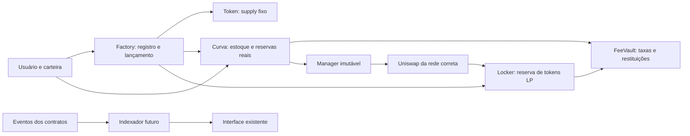

# Arquitetura candidata do protocolo

Extensão ao PRD e à infraestrutura existentes, conforme [índice e proveniência](README.md). A Fase 2 especifica responsabilidades; não implementa contratos ou transações.

## Componentes e fronteiras

| Componente | Responsabilidade e custódia | Permissões |
|---|---|---|
| RetryFactory | Registro de identidades; configuração por lançamento; criação e compra inicial atômicas | Lançamento público; novos presets somente pelo timelock, dentro de limites aprovados |
| RetryToken | ERC-20 de oferta fixa; cap por saldo enquanto a curva opera | Emissão única na inicialização; sem mint, burn administrativo, confisco, taxas de transferência ou upgrade |
| RetryCurve | Estoque C; ETH real R; compra/venda; quotes e estados | Buy/sell públicos; lançamento inicial só pela Factory; migração só no caminho fixado |
| RetryFeeVault | Créditos de taxas por ativo/beneficiário e restituições segregadas | Depósitos autenticados de fontes registradas; cada beneficiário reclama apenas seu crédito |
| RetryGraduationManager | Adapter imutável para DEX/chain/configuração; settlement e validação da LP | Curve registrada autoriza movimentação; acionamento público via curva, sem destinos livres |
| RetryLiquidityLocker | Reserva L, NFT criada na graduação, excedentes e receitas LP | Registro somente do manager esperado; coleta de taxas pública para destinos fixos; nenhum saque de principal |
| RetryGovernance | Timelock e configuração limitada de lançamentos futuros | Não controla reservas, oferta, registro, NFT ou saldos de usuários |

Factory mantém o registro: não criar outro contrato de registry sem necessidade. FeeVault pode ser compartilhado com créditos identificados por lançamento e ativo. Tokens e curvas são por lançamento, isolando reservas e falhas. Um manager compartilhado é aceitável se não mantém saldos persistentes nem permite chamadas arbitrárias; se a lógica couber com segurança na curva, avaliar eliminar esse contrato após benchmark.

Para primeira implementação, preferir deploys simples e bibliotecas estabelecidas. Clones são otimização posterior: inicialização única, implementação desabilitada e ausência de janelas de tomada de controle devem ser provadas antes de adotá-los. Dependências OpenZeppelin não tornam o conjunto auditado.

## Fluxo e autoridade

Somente o token é emitido; reservas virtuais são números de preço. Factory/manager não recebem uma autorização irrestrita de transferência de NFTs ou de execução arbitrária. O manager recebe allowances exatas durante a migração e elas são zeradas após uso. A posição deve nascer sob custódia do locker; não depender de uma transferência futura executada por administrador.

## Cap por saldo

Proposta: 5% de S, fixo por lançamento, para qualquer endereço externo enquanto ACTIVE/READY. A mesma regra aplica-se ao criador, contratos, transfer e transferFrom. A exceção é uma lista fechada de endereços do próprio lançamento para emissão, estoque, reserve LP e settlement, com direções/estágios limitados; não uma permissão para isentar qualquer contrato.

Transferências diretas de usuários para estoques do protocolo devem reverter; vendas entram pelo caminho autorizado. Isso evita contabilizar doações como estoque vendável. Token deve tratar self-transfer/zero e allowance como ERC-20, sem bypass do cap. Em MIGRATING, somente movimentos exatos previstos pelo settlement; desativação do cap vem após validação da LP, no mesmo rollback domain. GRADUATED segue ERC-20 livre do cap inicial. Transferências para outra carteira liberam capacidade na carteira original; isso é intencional no modelo por saldo e não prova proteção Sybil.

## Dados, frontend e indexador futuro

Reutilizar wagmi/viem/TanStack Query do módulo Web3. Não adicionar conectores nem introduzir send/sign na Fase 2. Na integração posterior, uma única árvore de providers recebe ABI e manifesto por rede com status NOT_DEPLOYED até implantação autorizada e verificada.

Tipos financeiros futuros devem carregar chainId, tokenAddress, curveAddress, configHash e unidades inteiras: grossWei, feeWei, netReserveWei, tokenAtoms, minOut, deadline. Preço é fração; USD e `number` são projeções visuais. Não reutilizar os preços fictícios como quotes ou fallback em falha RPC. Reconsultar estado e simular a chamada antes de solicitar assinatura, sem prometer que a simulação reserva estado.

Indexer proposto: processo simples e PostgreSQL quando necessário. Chave de evento canônico `(chainId, transactionHash, logIndex)`, com blockNumber/blockHash, transactionIndex e identidade do contrato. Reorganização remove ou marca eventos órfãos antes de aplicar a nova cadeia e recalcular derivados. Histórico bruto pode usar também blockHash para preservar forks. Checkpoint só avança em transação junto dos efeitos; reprocessar é idempotente. Ordenar por bloco, txIndex, logIndex. Não tratar confirmação fixa como finalização garantida: distinguir pending, included, safe e finalized conforme RPC da rede.

Paginação por cursor, limites de consulta, rate limits, tentativas com backoff, duas fontes RPC independentes em produção, detecção de divergência, lag e health checks são necessários. Banco/cache não alteram saldos, taxas ou elegibilidade. Quotes executáveis vêm da curva. Não há razão para adicionar esse backend nesta fase de modelagem.

Metadados são conteúdo não confiável: ponteiro limitado e, se aprovado, imutável com digest; repetir validação de imagens no servidor, reencodar raster, limitar bytes/dimensões, bloquear SSRF e exibir texto escapado. Relatos/moderação afetam descoberta e rótulos, com motivo verificável, sem modificar registro nem fluxo financeiro. Conectar uma carteira não autentica uma conta de backend; autenticação por desafio, nonce e expiração seria uma especificação separada.
